# purrfile 🐾

[](https://github.com/teodoramz/purrfile/actions/workflows/ci.yml)
[](https://github.com/teodoramz/purrfile/releases/latest)
[](https://github.com/marketplace/actions/purrfile)

A pixel cat for your GitHub profile, redrawn every night from your public activity.

<p align="center">
  
</p>

<picture>
  <source media="(prefers-color-scheme: dark)" srcset="docs/demo-hunter-dark.svg" />
  
</picture>

- **Desktop:** a retro desktop with your pinned repos, an `about_me.txt`, and a cat that says one
  line about your GitHub and a few cat jokes each day.
- **Snake hunter:** adds the cat to your [Platane/snk](https://github.com/Platane/snk) snake. It
  waits, pounces, and the loop starts again.

## Usage

Add a step after Platane/snk in your profile repo's workflow. A full example is in
[examples/profile-workflow.yml](examples/profile-workflow.yml).

```yaml
- uses: teodoramz/purrfile@v1
  with:
    desktop: dist/desktop.svg
    snake: dist/github-snake.svg dist/github-snake-dark.svg
```

Then add `desktop.svg` to your README next to the snake images.

| Input | Default | What it does |
| --- | --- | --- |
| `desktop` | | Where to write the desktop SVG |
| `snake` | | snk SVGs to add the cat to (changed in place) |
| `cat-name` | `Mochi` | The cat's name |
| `extra-lines` | | A text file of your own lines, one per line |
| `login` | repo owner | Whose profile to draw |
| `token` | `github.token` | Only reads public data |

If something goes wrong, it prints a warning and keeps the previous images.

## License

MIT
